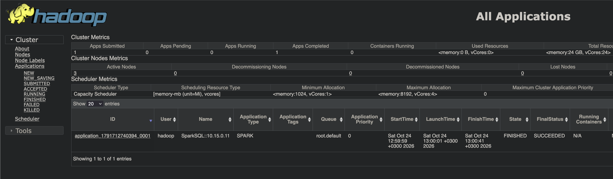
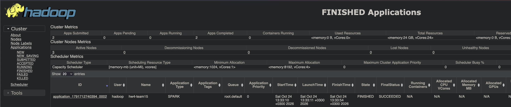
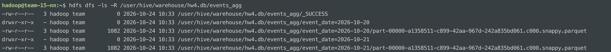
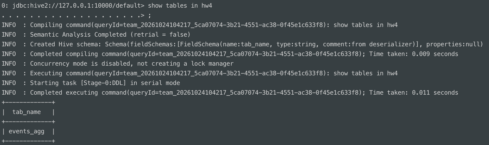
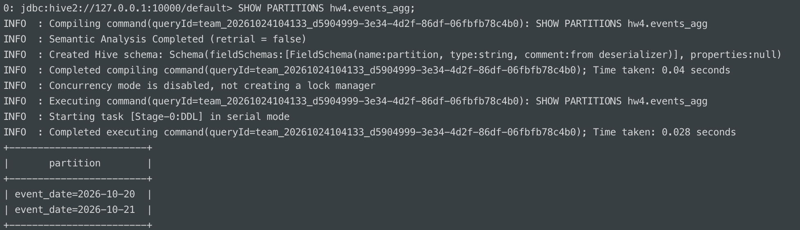
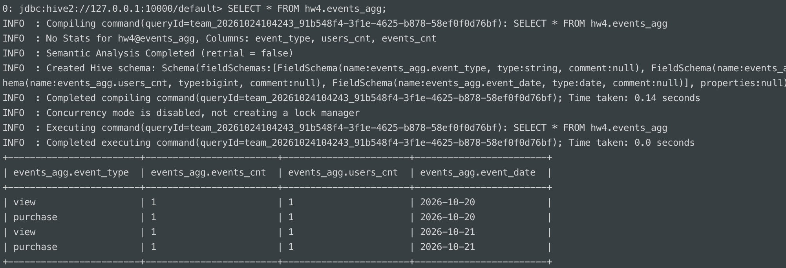

# ДЗ 4. Apache Spark под управлением YARN

## Состав

- job.py — чтение данных из HDFS, трансформации, запись партиционированной таблицы.
- conf/hive-site.xml — адрес Hive Metastore для Spark.
- conf/spark-defaults.conf — запуск в YARN и ресурсы.
- scripts/ — шаги из этого README в виде скриптов.
- *.png — результаты проверок.

Исходные данные — таблица hw3.events из ДЗ 3:
/user/team/hw3/events/event_date=YYYY-MM-DD/events.csv.

## Запуск скриптами

Скопировать каталог spark-hw4 на team-15-nn (пользователь hadoop)
и на team-15-en (пользователь team), перейти в него и выполнить
скрипты по порядку:

| № | Узел       | Пользователь | Команда                         | Что делает                                                                            |
|---|------------|--------------|---------------------------------|---------------------------------------------------------------------------------------|
| 1 | team-15-nn | hadoop       | `bash scripts/install-spark.sh` | Скачивает и распаковывает Spark, прописывает переменные в ~/.bashrc, копирует конфиги |
| 2 | team-15-nn | hadoop       | `source ~/.bashrc`              | Применяет переменные окружения в текущей сессии                                       |
| 3 | team-15-nn | hadoop       | `bash scripts/check-env.sh`     | Проверяет доступность Metastore и чтение hw3.events через spark-sql                   |
| 4 | team-15-nn | hadoop       | `bash scripts/run-job.sh`       | Запускает job.py в YARN                                                               |
| 5 | team-15-nn | hadoop       | `bash scripts/check-hdfs.sh`    | Показывает партиции таблицы в HDFS                                                    |
| 6 | team-15-en | team         | `bash scripts/check-hive.sh`    | Читает таблицу через beeline                                                          |

Скрипты проверяют узел и пользователя и завершаются, если они
не совпадают. Повторный запуск install-spark.sh не скачивает Spark заново. Ниже те же шаги описаны вручную.

## Установка (team-15-nn, пользователь hadoop)

Скачать и распаковать Spark:
```bash
wget https://dlcdn.apache.org/spark/spark-3.5.9/spark-3.5.9-bin-hadoop3.tgz

tar -xzf spark-3.5.9-bin-hadoop3.tgz
```

Задать переменные окружения:

```bash
export SPARK_HOME=/home/hadoop/spark-3.5.9-bin-hadoop3

export HADOOP_CONF_DIR=/opt/hadoop/etc/hadoop

export YARN_CONF_DIR=$HADOOP_CONF_DIR

export PATH=$PATH:$SPARK_HOME/bin
```

Через HADOOP_CONF_DIR Spark получает core-site.xml (адрес HDFS)
и yarn-site.xml (адрес ResourceManager)

Скопировать конфиги из репозитория:
```bash
cp conf/hive-site.xml conf/spark-defaults.conf $SPARK_HOME/conf/
```

## Предварительная проверка

До запуска должны работать HDFS, YARN и Metastore с HiveServer2
(см. ДЗ 1–3).

```bash
nc -zv team-15-en 9083
spark-sql -e "SHOW DATABASES; SELECT * FROM hw3.events;"
```

Ожидается база hw3 и четыре строки. Приложение `SparkSQL` появляется
в `YARN UI` со статусом `SUCCEEDED`:



## Запуск задачи

```bash
spark-submit job.py
```

Что делает `job.py`:

1. Создаёт SparkSession с master=yarn и поддержкой Hive.
2. Читает CSV из HDFS (/user/team/hw3/events). Колонка event_date
   берётся из имён папок партиций.
3. Преобразует типы: event_id и user_id в int, event_date в date.
   Нормализует event_type (trim, lower), удаляет строки с пустыми ключами.
4. Агрегирует по (event_date, event_type): число событий events_cnt
   и число уникальных пользователей users_cnt.
5. Сохраняет результат в таблицу hw4.events_agg в формате parquet
   с партиционированием по event_date (`partitionBy` + `saveAsTable`).
6. Печатает партиции и содержимое таблицы.

Повторный запуск перезаписывает таблицу (mode overwrite).

YARN UI открывается через SSH-туннель:

    ssh -L 8088:team-15-nn:8088 team@111.88.130.160

Затем открыть http://localhost:8088, раздел Applications. Там должно
быть приложение hw4-team15.



## Проверка в HDFS

```bash
hdfs dfs -ls -R /user/hive/warehouse/hw4.db/events_agg
```

Ожидаются папки `event_date=2026-10-20` и `event_date=2026-10-21`
с parquet файлами.



## Проверка через Hive

На team-15-en:

```bash
/opt/hive/bin/beeline -u 'jdbc:hive2://127.0.0.1:10000/default' -n team
```

Выполнить SQL:

```SQL
SHOW TABLES IN hw4;
SHOW PARTITIONS hw4.events_agg;
SELECT * FROM hw4.events_agg;
```

Ожидаются 1 таблица, две партиции и 4 записи





